<div align="center">

# ⚡ ELYRA OS
### *Your device. Your rules.*

[](https://github.com/jojin1709)
[](LICENSE)
[](https://github.com/jojin1709/elyra-os/actions/workflows/ci.yml)
[](https://jojin1709.github.io/elyra-os/)
[-3DDC84.svg?logo=android&logoColor=white)](https://source.android.com)
[-4285F4.svg?logo=google&logoColor=white)](docs/adr/0001-reference-device.md)
[](https://source.android.com/docs/core/architecture/kernel/generic-kernel-image)
[](docs/plans/02-standards-and-testing-strategy.md)

<p align="center">
  <strong>Developed &amp; Engineered by <a href="https://github.com/jojin1709">JOJIN JOHN</a></strong>
</p>

<p align="center">
  <strong>Elyra OS is an independent, freedom-first, privacy-focused, high-performance mobile operating system built directly from the Android Open Source Project (AOSP) and the upstream Linux kernel.</strong>
</p>

<p align="center">
  <em>A real, bootable operating system engineered for flagship fluidity, transparent user sovereignty, zero non-consensual telemetry, and uncompromised cryptographic integrity.</em>
</p>

---

</div>

> [!IMPORTANT]
> **Real Bootable Operating System:**
> Elyra OS is **NOT** a launcher, custom skin, Magisk module, or mock UI prototype. It is a fully engineered, bootable smartphone operating system with its own system experience, IPC services layer, security telemetry engine, and cryptographic update pipeline.

> [!TIP]
> **AI Agents & Engineers:**
> Inspect [`docs/STATE.md`](docs/STATE.md) for live phase tracking, [`docs/ROADMAP.md`](docs/ROADMAP.md) for exit criteria, and [`docs/ARCHITECTURE.md`](docs/ARCHITECTURE.md) for the 15-layer modularity breakdown.

---

## Table of Contents

- [What is Elyra OS?](#what-is-elyra-os)
  - [The Core Philosophy](#the-core-philosophy)
  - [Why Elyra OS Exists](#why-elyra-os-exists)
  - [Freedom Never Means Disabling Security](#freedom-never-means-disabling-security)
  - [Zero Non-Consensual Telemetry](#zero-non-consensual-telemetry)
- [System Architecture (15 Layers)](#system-architecture-15-layers)
- [First-Party Software Stack](#first-party-software-stack)
  - [Elyra Security Center](#1-elyra-security-center)
  - [Elyra Privacy Center](#2-elyra-privacy-center)
  - [Design Token System & Calm Aesthetics](#3-design-token-system--calm-aesthetics)
  - [Runtime Resource Overlays (RRO)](#4-runtime-resource-overlays-rro)
  - [Elyra System Services (AIDL)](#5-elyra-system-services-aidl)
- [Key Capabilities](#key-capabilities)
- [Modularity Matrix](#modularity-matrix)
- [Quick Start & Local Development](#quick-start--local-development)
  - [Prerequisites](#prerequisites)
  - [Host Capability Check](#1-check-host-capabilities)
  - [Generating Design Tokens](#2-generate-design-tokens)
  - [Standalone App Development](#3-standalone-app-development)
  - [Full Platform AOSP Build](#4-full-platform-aosp-build)
- [Phase Roadmap](#phase-roadmap)
- [Documentation Index](#documentation-index)
- [Hardware & Flashing Reality](#hardware--flashing-reality)
- [Frequently Asked Questions (FAQ)](#frequently-asked-questions-faq)
- [License & Attributions](#license--attributions)

---

## What is Elyra OS?

Elyra OS is an open-source mobile platform founded on the belief that **you own your hardware**. In an era of non-removable telemetry, artificial bootloader locks, and bloated user interfaces, Elyra provides a calm, lightning-fast, and cryptographically verified alternative.

### The Core Philosophy
1. **User Sovereignty ("Your device. Your rules.")**: Total control over hardware capabilities, bootloader state, root solutions, and software packages.
2. **Privacy by Architecture**: Zero diagnostic pings, no advertising IDs, hardware-level sensor kill-switches, and live clipboard read monitoring.
3. **Sustainable Low-Latency Performance**: Zero background garbage-cleaner snake oil. Raw Linux cgroups memory management and 90Hz/120Hz frame timing.
4. **Honest Security Transparency**: Never hide security states or fake Play Integrity checks. The OS transparently reports verified boot grades and risk levels to the user.

<details>
<summary><strong>Why Elyra OS Exists</strong></summary>

Modern smartphone software has drifted away from user interests. OEM skins bundle background analytic services, push unsolicited notifications, and restrict user root access under the pretext of security. Meanwhile, purely community ROMs often bypass SELinux or weaken verified boot to "make things work."

Elyra OS proves that you do not need to compromise security to have freedom. You can have strict SELinux enforcement, hardware-backed Keystore, and custom AVB root-of-trust verification while maintaining full root compatibility and developer sovereignty.

</details>

<details>
<summary><strong>Freedom Never Means Disabling Security</strong></summary>

Many custom ROMs set SELinux to `permissive` or disable Android Verified Boot (AVB) to make custom builds bootable. Elyra OS strictly rejects this approach:
- SELinux remains **Enforcing** across all official builds.
- Releases are cryptographically signed with offline private keys (`$ELYRA_KEYS`).
- Bootloader re-locking is supported on reference hardware using custom public key hashes (`fastboot flash avb_custom_key pkmd.bin`).
- Unlocked bootloader states are honestly reported in the Security Center rather than hidden with bypass hooks.

</details>

<details>
<summary><strong>Zero Non-Consensual Telemetry</strong></summary>

On a clean install of Elyra OS, there are zero outgoing network packets until you explicitly open an app or configure network accounts. The platform strips proprietary analytics daemons, diagnostic reporting services, and advertising identifiers out-of-the-box.

</details>

---

## System Architecture (15 Layers)

Elyra OS divides the operating system into 15 distinct architectural layers, maintaining clean boundaries across hardware, vendor HALs, native daemons, framework services, and user applications:

```mermaid
flowchart TD
  subgraph User Experience
    L15["Layer 15: Freedom & Modular Extensions (MicroG · Terminal · Local AI)"]
    L14["Layer 14: Elyra Core Applications (Launcher · Settings · Files · Updater)"]
    L13["Layer 13: Elyra SystemUI (Status Bar · Quick Settings · Lock Screen)"]
    L12["Layer 12: Framework & RRO Overlays (Tokens · Dimens · Themes)"]
  end

  subgraph System Framework & IPC
    L11["Layer 11: Elyra System Services (Security Engine · Privacy Monitor · AIDL)"]
    L10["Layer 10: Android System Server (AMS · WMS · PMS · AppOps)"]
    L9["Layer 9: Native Frameworks (SurfaceFlinger · AudioFlinger · libgui)"]
    L8["Layer 8: Binder IPC Infrastructure (/dev/binder · AIDL Stubs)"]
  end

  subgraph Core Platform & Runtime
    L7["Layer 7: Bionic C Library & ART Runtime (dex2oat · Zygote)"]
    L6["Layer 6: Native Daemons & SELinux (keystore2 · netd · logd · init)"]
    L5["Layer 5: Android Init System (init.rc · ueventd · vold · FBE)"]
    L4["Layer 4: Hardware Abstraction Layer (Treble · AIDL HALs · Camera · Audio)"]
  end

  subgraph Kernel & Hardware
    L3["Layer 3: Linux Kernel GKI (Linux 6.1 · Binder · eBPF · Ashmem)"]
    L2["Layer 2: Bootloader & AVB 2.0 (PBL · SBL · ABL · avb_custom_key)"]
    L1["Layer 1: Silicon & Secure Element (Tensor G2 · Titan M2 · AMOLED)"]
  end

  L15 --> L14 --> L13 --> L12 --> L11 --> L10 --> L9 --> L8 --> L7 --> L6 --> L5 --> L4 --> L3 --> L2 --> L1
```



For the comprehensive breakdown and dependency matrices, see [`docs/ARCHITECTURE.md`](docs/ARCHITECTURE.md).

---

## First-Party Software Stack

Elyra OS includes custom-engineered first-party system components located in [`vendor/elyra/`](vendor/elyra/):

### 1. Elyra Security Center
- **Path**: [`vendor/elyra/apps/ElyraSecurityCenter/`](vendor/elyra/apps/ElyraSecurityCenter/)
- **Stack**: Kotlin + Jetpack Compose + ViewModels + Material3 Tokens
- **Features**:
  - Live hardware verified boot grade (`GREEN`, `YELLOW`, `ORANGE`, `RED`).
  - Physical bootloader lock telemetry (`ro.boot.flash.locked`).
  - Real-time SELinux enforcing validation.
  - File-Based Encryption (FBE) cryptographic status.
  - Plain-language *"Your device. Your rules."* advisory banner explaining state implications without alarmist popups.

### 2. Elyra Privacy Center
- **Path**: [`vendor/elyra/apps/ElyraPrivacyCenter/`](vendor/elyra/apps/ElyraPrivacyCenter/)
- **Stack**: Kotlin + Jetpack Compose + Reactive StateFlow
- **Features**:
  - System-wide hardware kill-switches for Camera and Microphone.
  - Real-time Clipboard Access Auditor tracking apps reading copied data.
  - Chronological 24-hour sensor access timeline with background indicators.
  - Zero-telemetry invariant assurance.

### 3. Design Token System & Calm Aesthetics
- **Path**: [`vendor/elyra/design/`](vendor/elyra/design/)
- **Single Source of Truth**: [`tokens.json`](vendor/elyra/design/tokens.json)
- **Token Compiler**: [`scripts/generate-tokens.py`](scripts/generate-tokens.py) generates Android XML colors/dimens and Kotlin Compose theme files automatically.
- **Themes**:
  - **Light**: Crisp daylight contrast (`#FFFFFF` surface, calm indigo accent `#2D5BFF`).
  - **Soft Dark**: Eye-comfort slate (`#121417` near-black surface).
  - **AMOLED**: True pure `#000000` black for OLED battery efficiency.

### 4. Runtime Resource Overlays (RRO)
- **Framework Overlay**: [`vendor/elyra/overlays/framework-res/`](vendor/elyra/overlays/framework-res/) (16dp card radius, 28dp dialogs, accelerated transition scales).
- **SystemUI Overlay**: [`vendor/elyra/overlays/SystemUI/`](vendor/elyra/overlays/SystemUI/) (Calm indigo accent, 2-column Quick Settings grid, AMOLED burn-in protection).

### 5. Elyra System Services (AIDL)
- **Security Engine**: [`IElyraSecurityService.aidl`](vendor/elyra/services/aidl/org/elyra/security/IElyraSecurityService.aidl)
- **Privacy Monitor**: [`IElyraPrivacyService.aidl`](vendor/elyra/services/aidl/org/elyra/privacy/IElyraPrivacyService.aidl)
- **SELinux Policies**: Dedicated private domain policies in [`vendor/elyra/sepolicy/private/`](vendor/elyra/sepolicy/private/).

---

## Key Capabilities

| Capability | What It Does | Why It Matters |
| :--- | :--- | :--- |
| **Custom AVB Re-locking** | Flash custom public key (`pkmd.bin`) and run `fastboot flashing lock`. | Enjoy custom OS freedom while retaining full bootloader verification. |
| **SELinux Enforcing Always** | Strict domain isolation with zero `neverallow` breaches. | Protects system against privilege escalation and local root exploits. |
| **Hardware Kill-Switches** | One-tap system-wide software-disconnect for camera and mic. | Guarantees sensors are dormant during sensitive meetings. |
| **Clipboard Auditor** | Real-time tracking of clipboard reads with count badges. | Detects background credential scraping by malicious apps. |
| **Pure AMOLED Theme** | Hard `#000000` background surfaces across all system apps. | Dramatically cuts display power draw on OLED screens. |
| **Root-Friendly Ecosystem** | Standard init_boot patching for Magisk, KernelSU, and APatch. | No proprietary root daemons; seamless compatibility with upstream tools. |
| **A/B Seamless Rollback** | Dual-slot OTA client with automated health-check rollback. | Prevents bricked devices during overnight automated updates. |

---

## Modularity Matrix

Elyra OS maintains a strict separation between **Core** and **Optional** components:

```
[ Core Platform (Always Present) ]
├── Android 15 Platform Base + GKI Kernel
├── Elyra SystemUI + RRO Theme Overlays
├── Elyra Security Center + Privacy Center
├── Elyra Launcher3 + Files + Settings
└── Cryptographic A/B Update Engine

[ Optional Extensions (User-Selectable) ]
├── Sandboxed MicroG / GMS (User opt-in; never pre-installed silently)
├── Elyra Gaming & Thermal Governor (On-demand performance scaling)
├── Elyra Developer Terminal (Sandboxed root-friendly shell)
└── Local Offline AI Model APEX (100% offline, fully works without it)
```

---

## Quick Start & Local Development

### Prerequisites
- **Git** & **Python 3.10+** (for token generation and repo tooling).
- **Ubuntu 22.04/24.04 LTS** or **WSL2** on Windows.
- **Android SDK / Android Studio** (if developing Elyra first-party apps locally).
- **For Full AOSP Builds**: 32 GB+ RAM and 400 GB+ free SSD storage space.

### 1. Check Host Capabilities
Verify your local machine's build readiness:
```bash
bash scripts/check-host.sh
```

### 2. Generate Design Tokens
Compile the single-source token definition into Android XML and Kotlin Compose code:
```bash
python scripts/generate-tokens.py
```
*Outputs generated into `vendor/elyra/design/generated/`.*

### 3. Standalone App Development
You can develop, modify, and test Elyra first-party system apps directly without building the entire 400 GB AOSP tree:
- **Security Center**: [`vendor/elyra/apps/ElyraSecurityCenter/`](vendor/elyra/apps/ElyraSecurityCenter/)
- **Privacy Center**: [`vendor/elyra/apps/ElyraPrivacyCenter/`](vendor/elyra/apps/ElyraPrivacyCenter/)

Open the app directories in Android Studio or build using Gradle to install and preview on any Android 14/15 device or emulator.

### 4. Full Platform AOSP Build
When building a complete, bootable operating system image:
```bash
# 1. Point to your external AOSP build tree
export ELYRA_AOSP=~/elyra-aosp
export ELYRA_REPO=$(pwd)

# 2. Sync Elyra modules into the AOSP tree
./scripts/sync-vendor.sh

# 3. Initialize build environment and lunch
cd $ELYRA_AOSP
source build/envsetup.sh

# Target Google Pixel 7 (Physical Device)
lunch aosp_panther-userdebug

# OR Target Google Cuttlefish (Virtual Headless Emulator)
lunch aosp_cf_x86_64_phone-userdebug

# 4. Compile system images
export USE_CCACHE=1 && ccache -M 100G
m -j$(nproc)
```

---

## Phase Roadmap

Elyra OS development follows a gated, 11-phase engineering roadmap. A phase is marked complete **only** when all exit criteria pass:

| Phase | Milestone | Focus Area | Status |
| :---: | :--- | :--- | :---: |
| **P0** | **Architecture & Foundation** | Master Architecture, ADRs, Repo layout, Design Language | **APPROVED** |
| **P1** | **Boot Baseline** | Cuttlefish headless boot & reference device 20-reboot test | *In Progress* |
| **P2** | **Hardware Bring-Up** | Display, touch, audio, Wi-Fi, BT, cameras, sensors, cellular | *Pending P1* |
| **P3** | **System Experience** | Elyra SystemUI, Launcher, Settings, Privacy & Security Centers | **Active** |
| **P4** | **Privacy & Security** | Enforcing SELinux, AVB 2.0 release signing, kill-switches | *Pending P2* |
| **P5** | **Freedom Layer** | Custom key relock docs, Magisk/KernelSU integration, adb | *Planned* |
| **P6** | **Performance Engine** | RAM optimization, cold launch <400ms, thermals, battery | *Planned* |
| **P7** | **OTA & Recovery** | Signed A/B updates, rollback protection, payload tests | *Planned* |
| **P8** | **Advanced Modules** | Gaming governor, pure AMOLED enhancements, optional AI | *Planned* |
| **P9** | **Daily Driver Alpha** | 2-week continuous real-device validation, crash reports | *Planned* |
| **P10**| **Production Stable** | Full CTS/VTS suite, release signing, public launch | *Planned* |

*Track real-time progress in [`docs/STATE.md`](docs/STATE.md) and [`docs/ROADMAP.md`](docs/ROADMAP.md).*

---

## Documentation Index

| Document | Purpose |
| :--- | :--- |
| [`docs/ELYRA_SPEC.md`](docs/ELYRA_SPEC.md) | Official Product Specification & Philosophy. |
| [`docs/ARCHITECTURE.md`](docs/ARCHITECTURE.md) | Master 15-Layer Architecture & 6 Modularity Matrices. |
| [`docs/STATE.md`](docs/STATE.md) | Live tracking of current phase, decisions, and blockers. |
| [`docs/ROADMAP.md`](docs/ROADMAP.md) | Phase exit criteria and quality gates. |
| [`docs/adr/0001-reference-device.md`](docs/adr/0001-reference-device.md) | ADR 0001: Reference Device Selection (Pixel 7 `panther`). |
| [`docs/adr/0002-target-android-version.md`](docs/adr/0002-target-android-version.md) | ADR 0002: Platform Version Selection (Android 15). |
| [`docs/design/00-design-language.md`](docs/design/00-design-language.md) | Design Language & Specifications for all 12 Phase 3 screens. |
| [`docs/plans/01-repo-structure-and-build-env.md`](docs/plans/01-repo-structure-and-build-env.md) | Workspace layout, ccache setup, and toolchain guide. |
| [`docs/plans/02-standards-and-testing-strategy.md`](docs/plans/02-standards-and-testing-strategy.md) | Coding conventions, SELinux bounds, and CI test tiers. |
| [`docs/plans/03-risk-register-and-first-30-tasks.md`](docs/plans/03-risk-register-and-first-30-tasks.md) | Technical risk register and ranked 30-task backlog. |

---

## Hardware & Flashing Reality

> [!WARNING]
> **Anti-Brick Flashing Safety:**
> - Never flash images without confirming the device codename (`panther`) and active slot.
> - Always perform a dry-run test using `fastboot boot boot.img` prior to flashing permanent partitions.
> - Maintain official factory restore images and keep Google WebUSB Flash Tool accessible for recovery.

### Reference Device: Google Pixel 7 (`panther`)
- **SoC**: Google Tensor G2 (4nm / Titan M2 Security Chip)
- **AOSP Device Tree**: `device/google/pantah`
- **Kernel**: Android Common Kernel GKI 6.1 / 5.15
- **Driver Binaries**: Available officially from [developers.google.com/android/drivers](https://developers.google.com/android/drivers).

---

## Frequently Asked Questions (FAQ)

### Can I run Elyra OS without Google Play Services?
**Yes, absolutely.** Elyra OS does not bundle proprietary Google Mobile Services (GMS). The OS is 100% functional out-of-the-box using open-source utilities. For users who require specific apps depending on Google services, a sandboxed MicroG compatibility layer can be enabled with one tap.

### Is Elyra OS compatible with Magisk or KernelSU?
**Yes.** Elyra OS maintains complete compatibility with open-source root solutions (KernelSU, APatch, and Magisk) via standard `init_boot` image patching. The Security Center transparently detects and displays root presence to keep the user informed.

### Can I re-lock the bootloader after installing Elyra OS?
**Yes, on supported devices.** On our reference hardware (Google Pixel 7), you can extract your custom AVB public key (`avbtool extract_public_key`), flash it to the bootloader (`fastboot flash avb_custom_key pkmd.bin`), and re-lock the device (`fastboot flashing lock`). The device boots with verified boot in the **Yellow** state (custom root of trust).

### Can I compile Elyra OS on a laptop with limited disk space?
You can develop, modify, and build all Elyra first-party apps (Security Center, Privacy Center, Launcher, Themes) locally using standard Android SDK tools. However, compiling a full monolithic AOSP image (`system.img`) requires ~400 GB free SSD space and is best performed on an external SSD or dedicated remote build server.

---

## Author & Lead Architect

**JOJIN JOHN**
- **GitHub**: [@jojin1709](https://github.com/jojin1709)
- **Role**: Creator, Lead Architect & Core Systems Engineer for Elyra OS

---

## License & Ownership Notice

> [!CAUTION]
> **PROPRIETARY SOURCE CODE — ALL RIGHTS RESERVED:**
> **Copyright © 2026 JOJIN JOHN.**
> 
> All custom Elyra OS first-party software, applications ([`ElyraSecurityCenter`](vendor/elyra/apps/ElyraSecurityCenter), [`ElyraPrivacyCenter`](vendor/elyra/apps/ElyraPrivacyCenter)), design tokens, user interface specifications, system overlays, architecture plans, and documentation are the exclusive intellectual property of **JOJIN JOHN**.
> 
> **STRICT PROHIBITION ON COPYING, EDITING, AND REDISTRIBUTION:**
> No individual, team, or organization may copy, edit, alter, redistribute, mirror, publish, or sublicense any part of this repository or project without prior express written permission from **JOJIN JOHN**.
> 
> See the complete [LICENSE](LICENSE) for legal terms.

- **Upstream AOSP Components**: Unmodified upstream Android Open Source Project components remain licensed under Apache 2.0.
- **Linux Kernel Components**: Upstream Linux kernel components remain licensed under GPLv2.

**Elyra OS** — *Your device. Your rules.*

