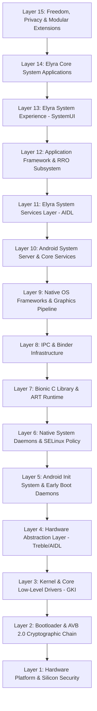

# Elyra OS — Master Architecture Specification (15 Layers & Modularity Matrix)

## Overview & Architecture Philosophy
Elyra OS is an independent, production-grade Android operating system founded on the Android Open Source Project (AOSP) and the upstream Linux kernel. Elyra delivers user sovereignty, real-time privacy transparency, sustainable low-latency performance, and enterprise-grade security.

Every component in Elyra OS follows the **Customization Precedence Hierarchy**:
1. **Product Configuration & System Properties** (`config.xml`, `product_config.mk`, system props).
2. **Runtime Resource Overlays (RRO)** (`vendor/elyra/overlays/`).
3. **Dedicated Elyra Modules & System Services** (`vendor/elyra/apps/`, `vendor/elyra/services/`).
4. **Upstream Patches** (strictly minimal, documented in `patches/` with an architectural decision record).

---

## The 15 Layers of Elyra OS

### Layer 1: Hardware Platform & Silicon Security
- **Description**: Physical silicon and specialized processing units. Includes the main Application Processor (CPU: ARM Cortex-X3/A715/A510), Graphics Processing Unit (GPU: Mali/Adreno), Neural Processing Unit (NPU/TPU), Baseband Modem, Touch Controller, AMOLED Display Panel, and Hardware Security Module (Titan M2 on Pixel reference hardware).
- **Elyra Role**: Elyra interfaces with the hardware strictly via standard VINTF and Treble specifications without bypassing hardware thermal, power, or battery limits.

### Layer 2: Bootloader & Cryptographic Verification Chain
- **Description**: The boot sequence comprising Primary Bootloader (ROM PBL), Secondary Bootloader (SBL), Android Bootloader (ABL), and Android Verified Boot (AVB 2.0). Governs partition verification (`vbmeta`), rollback protection index, fastboot protocol, and `fastbootd` userspace mode.
- **Elyra Role**:
  - Full support for `avb_custom_key` allowing user-flashed root-of-trust metadata (`pkmd.bin`) with re-locked bootloader verification (`ro.boot.verifiedbootstate=yellow`).
  - Transparent state reporting for locked (`green`/`yellow`) vs unlocked (`orange`) states in Elyra Security Center.

### Layer 3: Kernel & Core Low-Level Drivers
- **Description**: Linux Generic Kernel Image (GKI Linux 6.1 / 5.15), kernel defconfig fragments, eBPF subsystems, Ashmem, DMABUF heap allocators, memory cgroups (v2), and the Android IPC driver (`/dev/binder`, `/dev/vndbinder`, `/dev/hwbinder`).
- **Elyra Role**:
  - Clean upstream GKI baseline with no invasive kernel out-of-tree patches.
  - Full compatibility with KernelSU / APatch / Magisk open-source root hooks.
  - Strict preservation of kernel integrity and hardware safety margins.

### Layer 4: Hardware Abstraction Layer (HAL) & Treble/AIDL
- **Description**: The Treble hardware isolation boundary separating Android OS framework from vendor hardware specifics. Implemented via stable AIDL interfaces (`@VintfStability`): Camera3 HAL, Audio HAL, Display Composer (HWC3), Gralloc, Sensors, Biometrics (Fingerprint/Face), KeyMint/Gatekeeper, Health, and Radio Interface Layer (RIL).
- **Elyra Role**: Direct reuse of vendor HAL implementations extracted from official factory packages; zero vendor-tree modifications.

### Layer 5: Android Init System & Early Boot Daemons
- **Description**: First userspace process (`/system/bin/init`), executing `/system/etc/init/*.rc` and `/vendor/etc/init/*.rc`. Manages filesystem mounts (`/system`, `/vendor`, `/product`, `/data`), early services (`ueventd`, `servicemanager`, `hwservicemanager`, `vold`), and cryptographic key derivation for File-Based Encryption (FBE).
- **Elyra Role**:
  - Elyra-specific service stanzas defined in `/vendor/elyra/services/` with isolated `.rc` files.
  - Guaranteed enforcement of FBE (AES-256-XTS/Adiantum) and metadata encryption.

### Layer 6: Native System Daemons & SELinux Policy
- **Description**: Userspace native background daemons and security enforcement: `keystore2` (written in Rust), `netd`, `logd`, `tombstoned`, `installd`, `dnsmasq`, and the Linux kernel SELinux security module.
- **Elyra Role**:
  - SELinux remains strictly in **Enforcing** mode across all builds.
  - Zero tolerance for `neverallow` violations or permissive workarounds.
  - Elyra native services run in dedicated domains defined in `vendor/elyra/sepolicy/`.

### Layer 7: Bionic C Library & Android Runtime (ART)
- **Description**: Android's custom libc/libm/libdl (Bionic) optimized for low memory overhead and mobile workloads; Android Runtime (ART) with hybrid Ahead-of-Time (dex2oat) and Just-in-Time (JIT) compilation, garbage collector (CC/CMC), and the Zygote process pool.
- **Elyra Role**: Unmodified upstream AOSP ART and Bionic for 100% binary API/ABI stability and app compatibility.

### Layer 8: IPC & Binder Infrastructure
- **Description**: High-throughput inter-process communication infrastructure consisting of `/dev/binder`, `libbinder`, `libbinder_ndk`, AIDL code generators, and parcel serialization.
- **Elyra Role**: Elyra system services communicate with framework and privileged apps using strictly versioned, stable AIDL interfaces.

### Layer 9: Native OS Frameworks & Graphics Pipeline
- **Description**: C++ native platform frameworks: `SurfaceFlinger` (display composition and buffer routing), `libgui`, `AudioFlinger`, `MediaCodec`, and `InputFlinger` (event dispatching for touch and keys).
- **Elyra Role**: Stock upstream pipelines tuned for 90Hz/120Hz display refresh with zero dropped frames or composition latency.

### Layer 10: Android System Server & Core Services
- **Description**: The core Java process (`system_server`) hosting foundational OS services: `ActivityManagerService` (AMS), `WindowManagerService` (WMS), `PackageManagerService` (PMS), `AppOpsService`, `PermissionManagerService`, `StorageManagerService`, and `PowerManagerService`.
- **Elyra Role**:
  - AOSP core services reused as upstream baseline.
  - Privacy and security signals extracted via non-invasive system APIs, `AppOpsManager`, and official framework listeners.

### Layer 11: Elyra System Services Layer (New Custom Services)
- **Description**: Custom privileged system services engineered specifically for Elyra OS, exposed through AIDL interfaces:
  1. `ElyraSecurityService`: Aggregates AVB status, SELinux enforcement, root state, patch level, ADB status, and dev options.
  2. `ElyraPrivacyMonitorService`: Real-time AppOps monitoring, clipboard read audit log, background sensor activity tracker, and camera/mic indicators.
  3. `ElyraPerformanceEngine`: Lightweight governor profiling app launch latency, memory pressure (PSI), and background idle CPU consumption.
  4. `ElyraFreedomService`: Transparent state reporting, custom key validation, and safe developer option toggles.
  5. `ElyraUpdateService`: A/B update orchestrator communicating with `update_engine` for cryptographically signed delta and full updates.

### Layer 12: Application Framework & RRO Subsystem
- **Description**: Android Java/Kotlin SDK API surface, Jetpack libraries (Compose, Lifecycle, Navigation), `SettingsLib`, `SystemUIPluginLib`, and the OverlayManagerService (OMS) handling Runtime Resource Overlays (RRO).
- **Elyra Role**: Elyra's design tokens and theme variants (Light, Soft Dark, AMOLED) are applied system-wide via deterministic RRO overlays compiling to static overlay packages.

### Layer 13: Elyra System Experience (SystemUI)
- **Description**: The primary system user interface: Status Bar, Quick Settings panel with custom Elyra tiles, Notification shade, Lock Screen and Keyguard, Gesture Navigation bar, Recent Apps overview, Power Menu, and Volume Sliders.
- **Elyra Role**:
  - Custom UI built on top of AOSP SystemUI using modern Kotlin, clean ViewModels, and Jetpack Compose where appropriate.
  - Follows the Elyra Design System: calm indigo accent, refined 16dp card radii, crisp typography (Inter/Roboto Flex), and zero cluttered effects.

### Layer 14: Elyra Core System Applications
- **Description**: Stock first-party applications shipping out-of-the-box with Elyra OS:
  - `ElyraLauncher`: Fast, fluid Launcher3-derived home screen with gesture customization and icon-pack support.
  - `ElyraSettings`: Streamlined Settings app integrating the Elyra Design System and dedicated top-level portals.
  - `ElyraPrivacyCenter`: Real-time permission timeline, sensor toggle kill-switches, and clipboard access log.
  - `ElyraSecurityCenter`: Transparent cryptographic status, verified boot grade, encryption state, and security advice.
  - `ElyraUpdater`: Seamless background OTA client with A/B slot rollback verification.
  - `ElyraFiles`: Clean, secure file manager based on AOSP DocumentsUI.

### Layer 15: Freedom, Privacy & Modular Extensions
- **Description**: Modular add-ons that can be enabled or omitted:
  - Sandboxed MicroG / GMS Compatibility Layer (user-opt-in, never pre-installed without explicit user choice).
  - Terminal & Developer Utilities (sandboxed shell, wireless adb helpers).
  - Offline On-Device AI models (100% offline, fully functional without it).
  - Gaming & Thermal Governor profiles.

---

## Modularity & Component Matrices

### Table 1: AOSP Reuse (Unmodified Upstream Components)
| Component | Subsystem / Path | Rationale for Reuse |
| :--- | :--- | :--- |
| **Bionic libc / libm** | `bionic/` | Standard POSIX C library; ensures 100% Android ABI/API binary compatibility. |
| **ART Runtime & Compiler** | `art/` | State-of-the-art AOT/JIT compilation, garbage collection, and Zygote initialization. |
| **SurfaceFlinger & libgui** | `frameworks/native/services/surfaceflinger/` | High-performance hardware-accelerated window compositor and buffer queue. |
| **AudioFlinger & Media** | `frameworks/av/services/audioflinger/` | Low-latency audio routing, media codec management, and HAL binding. |
| **Binder Driver & Libs** | `drivers/android/binder`, `frameworks/native/libs/binder` | Fundamental IPC mechanism of Android; proven speed and memory efficiency. |
| **SystemServer Core** | `frameworks/base/services/core/` | ActivityManager, WindowManager, PackageManager, and PowerManager foundations. |
| **update_engine** | `system/update_engine/` | Production A/B dual-slot delta and streaming update client daemon. |
| **recovery & fastbootd** | `bootable/recovery/` | Standard recovery environment and dynamic partition userspace flashing. |
| **AVB / libavb** | `external/avb/` | Android Verified Boot 2.0 verification and cryptographic descriptor parsing. |
| **WPA Supplicant & Hostapd**| `external/wpa_supplicant_8/` | Wi-Fi client and hotspot management communicating with Wi-Fi HAL. |

### Table 2: AOSP Modify (Overlay / Config / Minimal Patch)
| Component | Path / Strategy | Modification Method | Rationale |
| :--- | :--- | :--- | :--- |
| **Framework Resources** | `vendor/elyra/overlays/framework-res/` | Static RRO Overlay (`config.xml`) | Custom default themes, animation scales, default wallpapers, fonts. |
| **SystemUI Config** | `vendor/elyra/overlays/SystemUI/` | Static RRO Overlay (`config.xml`) | Quick Settings tile rows/columns, status bar layout insets, clock styles. |
| **Settings Defaults** | `vendor/elyra/overlays/Settings/` | Static RRO Overlay | Custom default preference ordering and branding strings. |
| **Launcher3 Quickstep** | `vendor/elyra/apps/ElyraLauncher/` | Upstream fork with modular branch | Grid options, custom gesture listener, search provider decoupling. |
| **PackageInstaller** | `packages/apps/PackageInstaller/` | Config overlay & theme injection | Elyra security prompt explaining APK permissions before installation. |
| **Build Core Properties** | `vendor/elyra/elyra_common.mk` | Product Makefile inheritance | Branding properties (`ro.elyra.version`, `ro.elyra.build.type`). |

### Table 3: Elyra Create (Custom Elyra Modules)
| Module Name | Type | Location | Architectural Purpose |
| :--- | :--- | :--- | :--- |
| **ElyraDesignTokens** | Token Library | `vendor/elyra/design/` | Single-source JSON design tokens compiled to Kotlin and Android XML styles. |
| **ElyraSecurityService** | System Service (AIDL)| `vendor/elyra/services/security/` | Centralized cryptographic, AVB, root, and system integrity status provider. |
| **ElyraPrivacyService** | System Service (AIDL)| `vendor/elyra/services/privacy/` | Real-time AppOps listener, clipboard auditor, and hardware kill-switch controller. |
| **ElyraSecurityCenter** | Privileged App | `vendor/elyra/apps/ElyraSecurityCenter/`| Flagship dashboard for bootloader, AVB grade, encryption, and attack surface. |
| **ElyraPrivacyCenter** | Privileged App | `vendor/elyra/apps/ElyraPrivacyCenter/` | Transparent app permission timeline, one-tap revocations, and privacy indicators. |
| **ElyraUpdater** | Privileged App | `vendor/elyra/apps/ElyraUpdater/` | Cryptographic A/B OTA client with automated health-check verification. |
| **ElyraFiles** | System App | `vendor/elyra/apps/ElyraFiles/` | Fast, clean, privacy-respecting file explorer with secure vault support. |
| **ElyraSEPolicy** | SELinux Rules | `vendor/elyra/sepolicy/` | Domain definitions, file contexts, and service contexts for Elyra daemons. |

### Table 4: Device-Vendor Dependencies (Proprietary / Hardware-Specific)
| Item | Source Location | Vendor Provider | Purpose |
| :--- | :--- | :--- | :--- |
| **Firmware Blobs** | `/vendor/firmware/`, `/modem/` | Google / Qualcomm / Samsung | Baseband radio, Bluetooth firmware, Wi-Fi MAC, NFC firmware. |
| **GPU User Drivers** | `/vendor/lib64/egl/` | ARM (Mali) / Qualcomm (Adreno) | Hardware Vulkan and OpenGL ES drivers for SurfaceFlinger and apps. |
| **Camera Vendor HAL** | `/vendor/lib64/hw/camera.*` | Google / OEM | ISP tuning, multi-camera pipeline, computational photography modules. |
| **Audio Vendor HAL** | `/vendor/lib64/hw/audio.*` | OEM / Cirrus / Qualcomm | Hardware acoustic processing, speaker calibration, microphone beamforming. |
| **Titan M2 KeyMint HAL**| `/vendor/bin/hw/android.hardware.security.keymint*` | Google | Hardware-backed cryptographic key generation, attestation, and gatekeeper. |
| **Fingerprint/Face HAL**| `/vendor/bin/hw/android.hardware.biometrics.*` | OEM | Hardware biometric sensor enrollment, template storage, and verification. |

### Table 5: Optional Modules (Compile-Time & Runtime Selectable)
| Module | Packaging Strategy | Default State | User Control |
| :--- | :--- | :--- | :--- |
| **Sandboxed MicroG / GMS** | Standalone installer package | **Disabled / Not Installed** | User can install via Elyra Setup Wizard or Settings with one tap. |
| **Local Offline AI Model**| Modular APEX / Shared Library | **Disabled / Not Installed** | User can download quantized on-device models for offline translation/text. |
| **Elyra Gaming Governor** | Privileged system plugin | **Enabled (Idle)** | Automatically tunes CPU/GPU scaling only during active game sessions. |
| **Elyra Terminal** | Sandboxed APK | **Optional (Settings toggle)** | Accessible via Developer Options for advanced terminal interaction. |
| **Developer Diagnostics** | Debug APKs in userdebug | **Disabled in user builds** | Retained in internal testing builds; stripped from production release builds. |

### Table 6: Experimental Subsystems (Phase 8+ Exploration)
| Subsystem | Research Focus | Risk Assessment | Gating Criteria |
| :--- | :--- | :--- | :--- |
| **Elyra Desktop Mode** | Multi-window desktop UI on external DisplayPort | Moderate (Window positioning & input routing) | Stable 60Hz dual-display rendering on Cuttlefish / Pixel 8. |
| **App Sandboxing Isolation** | Virtualized per-app storage namespaces | High (Compatibility with legacy scoped storage) | Zero CTS storage test regressions. |
| **Microkernel Security Shim** | Offloading sensitive cryptographic ops to Rust enclave | High (Requires custom hardware integration) | Functional prototype on Cuttlefish before physical hardware. |
