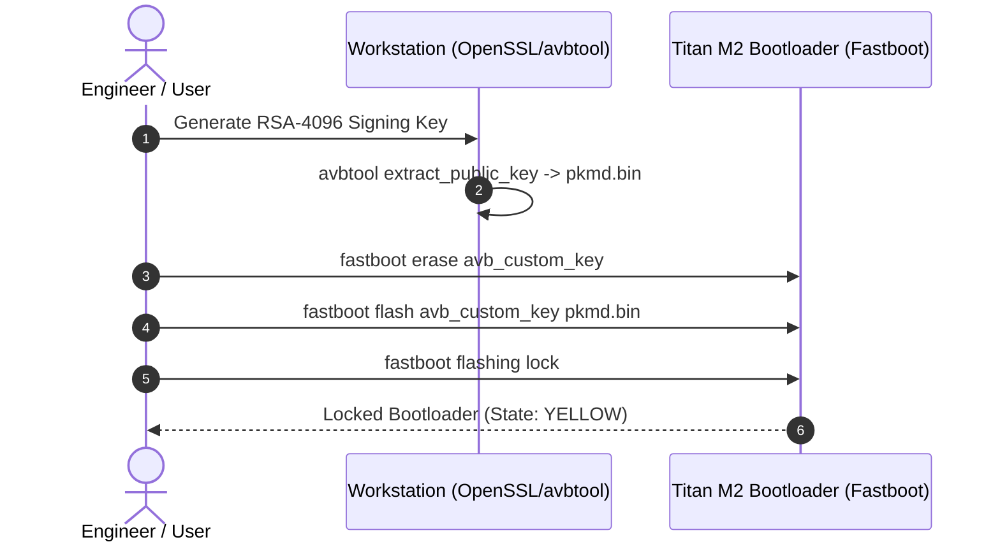

# Elyra OS — Freedom Layer: Bootloader Unlock & AVB Re-locking Guide

## 1. Overview & Philosophy
Elyra OS is built upon the principle of user sovereignty ("Your device. Your rules."). Unlike proprietary operating systems that penalize or permanently compromise devices when bootloaders are unlocked, Elyra OS provides a cryptographically secure, transparent path to **unlock and re-lock the bootloader using your own custom signing keys**.

---

## 2. Bootloader Unlocking Flow

### Prerequisites
- Google Pixel 7 (Codename: `panther`) or compatible reference device.
- USB-C cable and Android Platform Tools (`fastboot`, `adb`).
- Device battery at 50% or higher.

### Step 1: Enable OEM Unlocking
1. Boot into stock Android or existing OS.
2. Navigate to **Settings > About Phone**. Tap **Build Number** 7 times to enable Developer Options.
3. Open **Settings > System > Developer Options**.
4. Enable **OEM Unlocking** and **USB Debugging**.

### Step 2: Unlock in Fastboot Mode
```bash
# Reboot into fastboot mode
adb reboot bootloader

# Verify device communication
fastboot devices

# Initiate unlocking command
fastboot flashing unlock
```
*Follow on-screen prompt using Volume keys to select "Unlock the bootloader" and confirm with the Power button. Warning: This action wipes user data on `/data`.*

---

## 3. Cryptographic Re-Locking with Custom AVB Key

On Google Pixel devices equipped with the Titan M2 secure element, the bootloader supports **Android Verified Boot (AVB 2.0) Custom Root of Trust**. This allows you to lock the bootloader while running Elyra OS signed with your own private keys.



### Step 1: Generate Release Keys
*Keep your private keys offline in `$ELYRA_KEYS`. Never commit private keys to Git.*
```bash
mkdir -p "$HOME/.elyra-keys"
openssl genrsa -out "$HOME/.elyra-keys/elyra_avb.pem" 4096
```

### Step 2: Extract Public Key Metadata Descriptor (`pkmd.bin`)
```bash
avbtool extract_public_key \
  --key "$HOME/.elyra-keys/elyra_avb.pem" \
  --output "$HOME/.elyra-keys/pkmd.bin"
```

### Step 3: Flash Custom AVB Key to Hardware
```bash
# Boot into fastboot mode
adb reboot bootloader

# Clear any legacy custom key
fastboot erase avb_custom_key

# Flash your new public key descriptor to Titan M2
fastboot flash avb_custom_key "$HOME/.elyra-keys/pkmd.bin"
```

### Step 4: Re-Lock the Bootloader
```bash
fastboot flashing lock
```
*Select "Lock the bootloader" on the device screen. The device will reboot with `ro.boot.verifiedbootstate=yellow` (Custom Root of Trust), fully encrypted, and cryptographically verified.*

---

## 4. Returning to Factory Stock

To revert the device to Google stock firmware:
1. Re-open bootloader if locked: `fastboot flashing unlock`.
2. Erase the custom root-of-trust key:
   ```bash
   fastboot erase avb_custom_key
   ```
3. Flash the official Google factory image using `flash-all.sh`.
4. Re-lock to official Google root of trust:
   ```bash
   fastboot flashing lock
   ```
