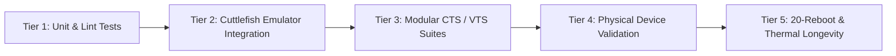

# Elyra OS — Standards, Testing Strategy & CI Plan

## 1. Coding & Engineering Standards

### Language Conventions
- **System Applications & SystemUI**: Modern **Kotlin** (100% strict null safety, Coroutines, StateFlow, Compose where applicable).
- **Android Framework Hooks**: **Java** where interfacing with legacy AOSP `frameworks/base` components; strictly documented and isolated.
- **Native Security & Daemons**: **Rust** (`rust_binary`, `rust_library`) preferred for all new security-sensitive native daemons; **C++20** (`cc_binary`) for HAL integration and low-latency graphics code.
- **IPC & Interfaces**: **AIDL** with explicit `@VintfStability` when crossing vendor partitions; explicit parcelable versions.
- **Build System**: **Soong** (`Android.bp`) exclusively. No legacy `Android.mk` for new modules.

### Quality & Review Gates
- **SELinux Compliance**: Every newly added daemon must define its own domain, type enforcement (`.te`), file context, and service context. No unvetted `permissive` domains in production builds.
- **No Secret/Key Exposure**: Production private keys (`$ELYRA_KEYS`) remain strictly offline and outside git tracking.
- **Zero Neverallow Breaches**: Zero modifications that violate upstream AOSP `system/sepolicy/public/neverallow`.

---

## 2. Multi-Tier Testing Strategy

### Tier 1: Unit & Component Testing
- Run locally via `atest <module_name>` (e.g. `atest ElyraSecurityServiceTest`).
- Robolectric and screenshot testing for Jetpack Compose UI components across Light, Dark, and AMOLED themes.

### Tier 2: Virtualized Integration Testing (Cuttlefish)
- Cloud/WSL2 integration testing using `aosp_cf_x86_64_phone-userdebug`.
- Automated headless boot test verifying:
  - System server startup without fatal crashes.
  - SystemUI keyguard and Launcher display.
  - Zero fatal SELinux denials in `logcat -b events`.

### Tier 3: Physical Hardware Validation (Reference Device: Pixel 7)
- Boot chain validation: Fastboot boot test before flashing.
- Complete hardware checklist in `docs/HARDWARE_STATUS.md`:
  - Display (90Hz refresh rate, HDR playback, brightness scaling).
  - Touch input & multi-touch gestures.
  - Audio (Stereo speakers, USB-C audio, microphone array).
  - Radios: Wi-Fi 6E, Bluetooth 5.2, Cellular voice/data (VoLTE), GPS/GNSS.
  - Cameras: Sensor streams, multi-camera switching, preview frames.
  - Biometrics: Fingerprint sensor calibration and authentication.
  - Battery & Thermals: Fast charging, thermals during heavy load.

### Tier 4: Stability & Longevity
- Automated 20 consecutive clean reboots test with zero bootloops or kernel panics.
- 48-hour idle battery drain benchmark logging CPU wake locks and sleep states (`pstore` and `batterystats`).

---

## 3. Continuous Integration (CI) Plan
- **Stage 1 (On Commit / PR)**:
  - Format checks (`ktlint`, `bpfmt`, `rustfmt`).
  - Soong blueprint validation (`Android.bp` syntax check).
  - SELinux policy compile check (`secilc` test).
- **Stage 2 (Nightly Build)**:
  - Incremental compile of `aosp_cf_x86_64_phone-userdebug`.
  - Smoke boot test on headless Cuttlefish instance.
  - Automated test artifact generation (OTA package and Fastboot zip).
- **Stage 3 (Release Candidate Tag)**:
  - Full clean build of `aosp_panther-userdebug` and `aosp_panther-user`.
  - Cryptographic signing with offline release keys (`sign_target_files_apks`).
  - Generation of `pkmd.bin` (custom AVB public key descriptor) for bootloader re-locking verification.
